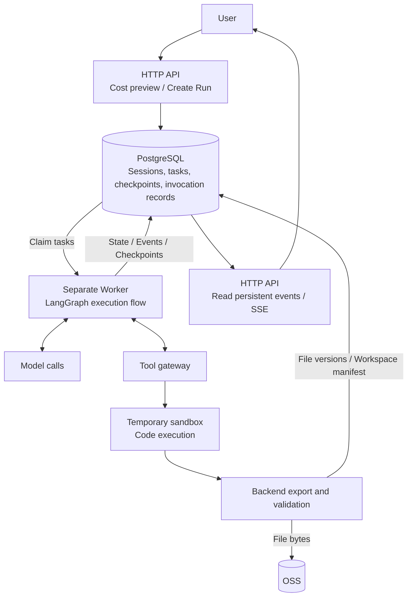

# From Self-Hosted OpenSandbox to Alibaba Cloud Sandbox: Cloud Agent Architecture Choices

In my earlier [notes on frontend and backend architecture](/en/posts/backend-frontend-architecture/), I wrote about the boundaries between APIs, business orchestration, databases, and asynchronous tasks.

Building the Cloud Agent raised another set of practical questions. A model can decide to call tools and generate code, but where should that code run? What happens if the connection drops during execution? Where do generated files go, and can they be modified again in the next turn?

The move from self-hosted OpenSandbox to Alibaba Cloud Sandbox was another adjustment around these questions. The clearest goal at the time was to reduce the layers we had to maintain and first get one basic flow working: a user sends a message, the model calls a tool, the sandbox executes code, a file is generated, the user downloads it, and then continues modifying it in the next turn.

I want to record that flow, along with what we kept and what we gave up during the switch.

## Separating the Execution Flow

The Cloud Agent still lives in the backend. The HTTP API handles authentication, cost previews, task creation, and status reads. A separate Worker handles long-running execution, while LangGraph organizes context, model calls, tool calls, pausing for input, and resuming execution.

For the code execution and file delivery path, the main relationships look like this:

There are three different objects here: Session, Run, and Invocation.

- A Session represents an ongoing conversation and stores messages and the current workspace.
- A Run represents one task started by the user and stores the configuration for that turn, its execution deadline, status, and checkpoint: a persistent record of how far the graph has progressed.
- An Invocation goes one level deeper and records a single model call or tool call.

Keeping them separate makes several things easier to explain. A task may still be running after the browser disconnects. The conversation and files remain after a task finishes. If the result of a tool call is temporarily unclear, the entire run does not have to be reduced to a simple success or failure.

The Cloud Agent Worker currently claims tasks directly from PostgreSQL. The database stores task state, execution ownership, and the position to resume from. The HTTP request returns once the task has been created, and the Worker takes over from there.

## Calls and Recovery Need Their Own Records

LangGraph handles the flow and the persistence interface for graph state, including waiting for input, interruption, and resumption. Whether an external system actually executed a request, files were fully saved, or billing was settled still needs separate records and checks.

For example, when another Worker takes over a task, the old process may still be running. If we only look at a status saying that the task is running, both processes may get a chance to keep writing results. Claiming a task therefore also needs a lease and an execution generation. Each takeover changes the execution identity, and writes must confirm that the Worker still owns the task. Even if the old Worker returns later, it cannot simply overwrite the current state.

Remote calls introduce another kind of uncertainty. Once a request has been sent, a local timeout does not mean the remote side did nothing. It may have completed successfully, with only the response failing to make it back. The current implementation preserves an unknown-result state and avoids immediately resending the request.

Whether the result can be retrieved depends on the call. Sandbox operations can be checked using the recorded instance identity and operation. When a model response is lost, the current implementation does not guarantee that the original output can be retrieved. The result may remain unknown, while usage and billing are checked separately against the original records.

On model-call paths that allow retries, bounded retries are allowed only when the request is known not to have been sent, or when a failure result that meets the rules has been received. Code execution, file publication, and billing are handled through their own original invocation records and must not be started again just because of a timeout. Otherwise, one network problem can turn into duplicate execution, duplicate outputs, or duplicate charges.

## What Self-Hosting OpenSandbox Required

When I first connected OpenSandbox, I wanted to keep code execution inside a separate environment. It provided a runtime and execution interfaces, along with considerable control over a self-hosted deployment.

But meeting our own isolation, file, and recovery requirements still meant building quite a few things around it: managing instance lifecycles and resource quotas, restricting network access, setting file permissions, observing execution, confirming stops, and exporting and collecting results.

Some of these are not difficult to build in isolation. The hard part is making them all hold together in the same flow.

A command returning does not mean all background child processes have stopped. A visible file does not mean it has stopped changing. Receiving a stop request does not mean the instance has actually been destroyed. The backend needs these confirmations before it can publish outputs, release resources, and handle later recovery.

The original approach gradually accumulated a Manager, quota and observation logic, and adapter code tied to a fixed runtime. They solved real problems, while also adding more boundaries to maintain and verify.

These experiences apply only to the version we used at the time and our own requirements. OpenSandbox also supports other deployment approaches, so this choice should not be generalized into a conclusion about the whole project.

## How the Managed Setup Divides the Work

We later switched to the second-generation MicroVM runtime of Alibaba Cloud Agent Sandbox Flash Edition, connecting through an E2B-compatible interface. In its comparison of its own two runtime generations, the official documentation also notes that similar interfaces can still differ in images, templates, networking, storage, and lifecycles, and need to be validated against real workloads. [Official runtime documentation](https://help.aliyun.com/en/agent-sandbox/runtime-gen1-vs-gen2)

This adjustment mainly changed how execution resources are provided. The trusted Worker continues to run the Agent flow, while cloud VMs handle untrusted code and isolated file validation.

Model calls, permission decisions, accounting, and recovery remain the backend's responsibility. Backend database, OSS, model, and signing credentials are not injected into the execution environment. The backend prepares and collects the files.

The division of work after the switch comes down to these choices:

| Area                 | Current choice                                                                                                                          |
| -------------------- | --------------------------------------------------------------------------------------------------------------------------------------- |
| Execution resources  | Use the managed sandbox to create and reclaim temporary VMs                                                                             |
| Agent flow           | Keep execution in our own Worker and LangGraph                                                                                          |
| Persistent state     | PostgreSQL stores execution state; OSS stores file bytes                                                                                |
| Workspace continuity | Restore through file versions and a manifest                                                                                            |
| Unknown results      | Keep the original invocation record, check what the adapter can establish, and avoid treating an unknown outcome as a retryable failure |

Choosing a managed service also introduces provisioning constraints. For this project's custom image delivery plan, we need a non-Economy Container Registry Enterprise Edition (ACR EE) instance in the same account and region, along with the corresponding VPC network for pulling images. These preparations and costs also count. This is the path for our custom second-generation image; using an official base image is a different case. [Official template documentation](https://help.aliyun.com/en/agent-sandbox/build-and-manage-custom-templates-with-code)

## Keeping Continuity in Files

The current implementation prepares a separate temporary VM for each `sandbox.execute` call that needs to execute code. A Run may execute no code at all, or call the code tool several times, so it may create zero, one, or multiple execution VMs. Recovery of the same call still checks the original operation; it does not create another VM to execute the program again.

Ordinary file reads and writes do not all require starting an execution VM, and isolated file validation has its own operation records.

Before each code execution, the backend prepares files from the current workspace manifest. This manifest maps file paths to immutable versions; the file bytes are stored in OSS.

For normal delivery, the backend first confirms that untrusted writer processes have stopped, then captures the complete files, exports them to OSS, and reads them back for verification. It must also confirm that the original VM has terminated, complete any required file validation, and check execution ownership and the original workspace version before publishing new file versions. Stopping writer processes and terminating the whole VM require two separate checks.

As an illustration of file flow, suppose the first code call generates `report.md` and the backend publishes its file version after the checks. A later code call loads that file into a new VM and changes its contents. The file carries over; the Python variables from the earlier execution do not.

The same conversation can therefore continue modifying files generated earlier, but it does not carry over in-memory variables, background processes, or temporarily installed environments from the previous VM.

Some interactive tasks need to be reorganized around this. Environments and dependencies that need to be consistently available fit better in a predefined template. Anything that needs to survive across calls should be explicitly written to a file.

Creating environments, restoring files, and exporting results each time also adds overhead that needs to be observed with actual tasks.

## Boundaries We Still Handle with a Managed Sandbox

Beyond file handoff, programs and arguments need validation, execution environments need restrictions, and exported files need checks for paths, types, sizes, and content digests. Results can be attached to the current session only while the run still owns execution and the workspace remains at its original version. A conflict must not overwrite a newer version.

Persistent records made before dispatching calls, stop and timeout handling, and recovery from unknown results also remain in our own backend.

I think this is another useful lesson from the move: even after handing infrastructure to a cloud service, the application still needs clear definitions of completed execution and usable outputs, as well as a way to identify external operations that remain unresolved.

The old OpenSandbox adapter also retains a compatibility path for recognizing old protocol records. Historical Runs and operations are tied to the original protocol, instance identity, and recovery rules; they cannot simply be switched to the new provider and rerun. Before retiring the old service, we need to separately check whether unresolved records remain and whether the old environment can actually support recovery. Keeping adapter code does not answer either question by itself.

## What Has Been Verified So Far

There are now real development-environment records of the minimal flow working end to end, including code execution, file delivery, and later modifications. But those records cover specific versions, configurations, and test scopes. They do not establish coverage for all models, arbitrary Skills, failure scenarios, or production deployments.

The same applies to costs. Reducing the layers we maintain was a clear goal of this move. Actual total cost also includes cloud resources, file transfers, image maintenance, and execution frequency. We do not yet have a complete quantitative comparison, so I am not calling it cheaper for now.

At this stage, I would rather first keep the execution flow and state boundaries clear: where a task runs, which file version is authoritative, what to query when a remote result is unknown, and when resources can be released.

Once these things can be observed and checked consistently, we will have a firmer basis for discussing environment reuse, execution efficiency, and cost.
