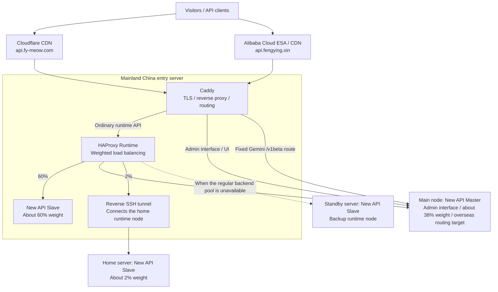
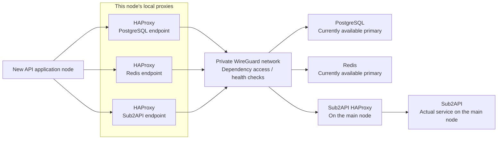
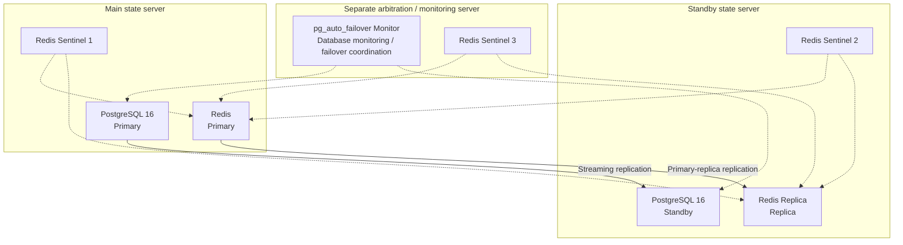

# Building a Practical High Availability Setup for New API

The IDC hosting my servers had been unstable recently, with frequent connection failures. I spent about a day putting together a practical high availability setup for New API, starting with a few single points of failure that could easily affect everyday use.

The entry server is the most important part of this setup, so I chose a cloud server from a major provider in mainland China. The other nodes mostly run on cloud servers from smaller IDC providers, along with one home server. I hope this gives me a workable balance between cost, throughput, and stability for now.

This is not yet a fully active-active system across the whole request path. I want to record how the parts connect, where failover is available, and which parts remain fragile, so I have something clear to look back on as I keep working on it.

## What I Wanted to Address First

For now, I mainly wanted to address five things:

1. Runtime API requests can be spread across multiple nodes instead of depending on one machine.
2. PostgreSQL has primary-standby replication, with pg_auto_failover handling automatic failover.
3. Redis has primary-replica replication and three Sentinel instances for monitoring, quorum, and failover.
4. Servers use a private WireGuard network to access the database, cache, and health check endpoints.
5. Applications on the entry, main, and standby nodes connect to local HAProxy endpoints, leaving backend role changes to the proxies and health checks.

The home node is a little different. It connects to the entry server through a reverse SSH tunnel and reuses the dependency proxies on that server.

## Entry Points and Runtime Traffic

There are currently two domain entry points: `api.fy-meow.com` goes through Cloudflare, and `api.fengying.xin` goes through Alibaba Cloud ESA / CDN. Both eventually reach Caddy on the entry server, which handles TLS, reverse proxying, and routing.

Ordinary runtime API requests then enter HAProxy's weighted backend pool. The approximate configured weights are:

| Node                      | Current role                                                                                    | Runtime weight                               |
| ------------------------- | ----------------------------------------------------------------------------------------------- | -------------------------------------------- |
| Mainland China entry node | New API Slave, handling most runtime requests                                                   | About 60%                                    |
| Main node                 | New API Master, also handling the admin interface, configuration writes, and channel management | About 38%                                    |
| Home server               | Connected through a reverse SSH tunnel for fallback and verification                            | About 2%                                     |
| Standby node              | New API Slave, taking over when the regular backend pool is unavailable                         | Backup, outside the normal weight allocation |

These are configured weights. The actual request distribution will not always be exactly 60 / 38 / 2.

Gemini takes a separate route. Its upstream connects directly to AI Studio, which has more regional restrictions, so I route `/v1beta` to a fixed overseas server. In the current routing setup, these requests go directly to the main node and do not join the ordinary weighted runtime pool.

The admin interface and UI also go directly to the Master. The Backup in the diagram is a fallback for the ordinary runtime pool; it does not mean these two direct routes have the same fallback path.

## How Applications Access Their Dependencies

I did not want every application node to be tied directly to the actual primary addresses of PostgreSQL and Redis, so I placed local HAProxy endpoints on the entry, main, and standby nodes.

Applications connect to the local proxies, which select backends through health checks. This lets the application keep using the same connection address when primary and standby roles change. A stable address does not guarantee that requests already in progress will survive a failover.

The diagram below combines the repeated parts, using an application on the entry or standby node as an example:

The actual Sub2API service currently runs on the main node. Other nodes reach the main node's Sub2API proxy through their local proxies and WireGuard, while the main node's own proxy connects directly to the local service. This adds access endpoints, but it does not add more Sub2API service replicas.

The home node takes an extra hop: the entry server sends runtime requests home through the tunnel, and the home node goes back through the tunnel to the entry server's HAProxy endpoints when accessing PostgreSQL, Redis, and Sub2API. The two request paths run in different directions, but both depend on the tunnel and the entry server.

## PostgreSQL and Redis Replication

The database runs PostgreSQL 16, with streaming replication between the main and standby nodes. The pg_auto_failover Monitor on a separate monitoring server coordinates database state and automatic failover.

Redis has one primary, one replica, and three Sentinel instances. There is one Sentinel on each of the main server, standby server, and separate arbitration / monitoring server, giving the cache layer its own monitoring and quorum.

This diagram shows the current primary and standby roles. Dotted lines represent monitoring or failover coordination. Application requests do not pass through the Monitor or Sentinel; data access still goes through the application-side HAProxy endpoints. After a failover, the primary and standby roles change too.

## What I Still Want to Improve

This setup separates failure handling for the runtime, database, and cache, but there are still a few areas I need to look at:

- Both CDN domains eventually reach the same entry server, so that server remains critical.
- The admin interface and the fixed Gemini route depend directly on the main node. They cannot simply use the ordinary runtime pool's fallback path.
- The actual Sub2API service still exists only on the main node. Local proxies do not make it active-active.
- The home node depends on the entry server and reverse SSH tunnel. It is better suited to low-weight fallback and cannot yet be treated as a fully independent recovery path.
- I still need to observe connection recovery, failed requests, and actual traffic distribution during failover before deciding what to improve next.

For now, I would rather put this setup to use and see how it behaves in practice. Keeping its boundaries clear also makes it easier to avoid confusing “having a standby node” with “having high availability across the whole request path” as I continue changing it.

If you have worked on a similar setup, or see any risks or areas that could be improved, I would be happy to hear about them.
