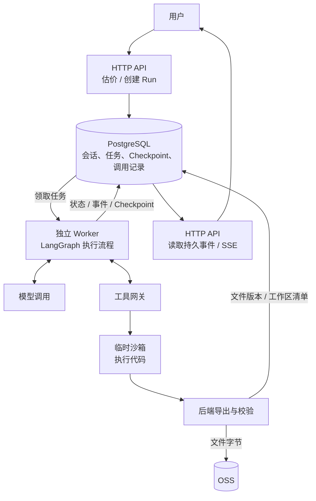

# 从自建 OpenSandbox 到阿里云沙箱：Cloud Agent 的架构取舍

之前在[前后端架构与调用流程整理](/zh/posts/backend-frontend-architecture/)里，我写过接口、业务编排、数据库和异步任务之间的边界。

继续做 Cloud Agent 时，这些问题又往前走了一步：模型可以决定调用工具，也可以生成代码，但代码应该在哪里执行？执行过程中连接断了怎么办？生成的文件放在哪里，下一次还能不能接着修改？

这次从自建 OpenSandbox 切换到阿里云沙箱，也是围绕这些问题做的一次调整。当时最明确的目标是减少维护层，先把一条基本流程跑通：用户发消息，模型调用工具，沙箱执行代码，生成文件，用户下载，然后在下一轮继续修改。

我想先把这条链路，以及切换时保留和放弃的东西记下来。

## 先把执行链路拆开

Cloud Agent 这一层仍然放在后端。HTTP API 负责鉴权、费用预览、创建任务和读取状态；独立 Worker 负责长时间执行，LangGraph 负责组织上下文、模型调用、工具调用和等待恢复。

沿着代码执行和文件交付这条路径看，主要关系是这样：

这里有三种不同的对象：Session、Run 和 Invocation。

- Session 对应一个持续的会话，保存消息和当前工作区。
- Run 对应用户发起的一次任务，保存本轮配置、执行期限、状态和 Checkpoint，也就是图执行到哪一步的持久记录。
- Invocation 再往下拆一层，记录一次模型调用或工具调用。

这样分开以后，很多事情会更容易说明白。浏览器断线时，任务可能还在运行；一次任务结束后，会话和文件仍然存在；某个工具的结果暂时不明确，也不需要把整轮执行简单地归成成功或失败。

目前 Cloud Agent 的 Worker 直接从 PostgreSQL 领取任务。数据库同时保存任务状态、执行权和恢复位置，HTTP 请求创建好任务后就返回，后续由 Worker 接手。

## 调用与恢复需要自己的记录

LangGraph 在这里负责流程和图状态的持久化接口，包括等待输入、中断和恢复。但外部系统有没有真正执行、文件有没有完整保存、费用有没有结清，还需要自己的记录和检查。

比如任务被另一个 Worker 接管时，旧进程可能仍在运行。如果只看“任务正在执行”，两个进程都有机会继续写结果。所以领取任务时还需要租约和执行代次：每次接管都会更新执行身份，写入前必须确认自己仍然拥有执行权。旧 Worker 即使晚一点返回，也不能直接覆盖当前状态。

远端调用还有另一类不确定性：请求发出去以后，本地超时并不能说明远端什么都没做。它可能已经执行成功，只是回复没有传回来。当前实现会保留“结果未知”，避免直接重发。

能否查回结果取决于具体调用。沙箱可以沿已经记录的实例身份和操作核对；模型响应丢失时，当前实现不保证取回原输出，调用结果可能继续保持未知，用量和账务则按原记录另外核对。

在允许重试的模型调用路径里，只有明确没有发送，或者已经拿到符合规则的失败结果，才进入有界重试。代码执行、文件发布和计费则沿各自的原调用记录处理，不能因为超时就重新发起，否则一次网络问题就可能变成重复执行、重复生成，或者重复收费。

## 自建 OpenSandbox 时需要承担什么

最初接入 OpenSandbox 时，我希望把代码执行收在一个独立环境里。它提供了运行时和执行接口，也给了自建部署比较多的控制空间。

但要满足我们自己的隔离、文件和恢复要求，周围还需要补很多东西：实例生命周期、资源配额、网络限制、文件权限、执行观察、停止确认，以及结果导出和接收。

其中一些事情单独做出来并不难，困难在于它们要在同一条链路里成立。

命令返回了，不代表后台子进程已经全部停止；能看到文件，不代表文件已经不再变化；收到停止请求，也不代表实例真的被销毁。只有这些事实能够接起来，后端才能放心发布成果、释放资源，并处理后续恢复。

旧路线里因此逐渐出现了 Manager、配额和观察逻辑，以及与固定运行时绑定的适配代码。它们解决的是实际问题，也意味着更多需要维护和验证的边界。

这些经历只对应我们当时使用的版本和自己的要求。OpenSandbox 也可以有其他部署方式，不能把这次选择推广成对整个项目的结论。

## 改用托管沙箱后的分工

后来切换到的是阿里云 Agent Sandbox 极速版二代 MicroVM，通过 E2B 兼容接口接入。官方在比较自家两代运行时时也提醒，接口相似的情况下，镜像、模板、网络、存储和生命周期仍可能有差异，需要用实际业务验证。[官方运行时说明](https://help.aliyun.com/zh/agent-sandbox/runtime-gen1-vs-gen2)

这次调整主要改变了执行资源的提供方式。可信的 Worker 继续运行 Agent 流程，云 VM 承接不可信代码和隔离文件验证。

模型调用、权限判断、账务和恢复仍然由后端负责。执行环境不会注入后端的数据库、OSS、模型或签名凭据，文件由后端准备和收回。

这次切换后的分工可以归到下面几项：

| 方面       | 当前选择                                                   |
| ---------- | ---------------------------------------------------------- |
| 执行资源   | 使用托管沙箱创建和回收临时 VM                              |
| Agent 流程 | 继续由自己的 Worker 和 LangGraph 执行                      |
| 持续状态   | PostgreSQL 保存执行状态，OSS 保存文件字节                  |
| 工作区延续 | 通过文件版本和 manifest 恢复                               |
| 未知结果   | 保留原调用记录，按适配器能力核对，避免把未知当成可重试失败 |

选择托管也带来供应约束。以这次自有业务镜像的交付方案为例，它要求同账号、同地域的非经济版 ACR 企业版镜像仓库，以及对应的 VPC 拉取网络。这些准备和费用也要算进去。这里说的是本项目的自定义二代镜像路径，使用官方基础镜像是另一种情况。[官方模板说明](https://help.aliyun.com/zh/agent-sandbox/build-and-manage-custom-templates-with-code)

## 连续性放在文件上

当前实现为需要实际执行的每次 `sandbox.execute` 调用准备独立临时 VM。一个 Run 可以完全不执行代码，也可以调用多次代码工具，因此可能创建零台、一台或多台执行 VM。同一次调用恢复时仍核对原操作，不另建一台 VM 重新执行。

普通文件读写并不都需要启动执行 VM，隔离文件验证还有自己的操作记录。

每次代码执行前，后端根据当前工作区清单准备文件。这份清单叫 manifest，记录文件路径对应哪个不可变版本；文件字节保存在 OSS 中。

正常交付时，要先确认不可信写入进程已经停止，再完整捕获文件、导出到 OSS 并回读校验。随后还要确认原 VM 已终止，完成必要的文件验证，并核对执行权和原工作区版本，才能发布新的文件版本。停止写入进程和终止整台 VM 需要分别检查。

举个只说明文件流转的例子：第一次代码调用生成 `report.md`，后端完成检查后发布文件版本；后续另一次代码调用在新的 VM 中载入这份文件，再修改内容。文件延续了，前一次执行里的 Python 变量没有跟着过去。

所以，同一个会话可以继续修改之前生成的文件，但不会延续上一台 VM 里的内存变量、后台进程或临时安装环境。

这会让一些交互式任务需要重新组织。需要稳定使用的运行环境和依赖，更适合提前放进固定模板；需要跨调用保留的内容，应当明确写成文件。

相应地，每次创建环境、恢复文件和导出结果也会产生开销，需要结合实际任务观察。

## 托管后仍然需要处理的边界

除了文件交接，程序和参数也需要校验，执行环境需要限制，导出文件需要检查路径、类型、大小和内容摘要。只有本轮仍拥有执行权，且工作区仍是原来的版本时，才能把结果挂到当前会话；发生冲突时，不能覆盖新版本。

调用发出前的持久记录、停止和超时处理、未知结果恢复，也都还在自己的后端里。

我觉得这也是这次迁移里比较值得留下的一点：基础设施交给云服务之后，业务仍然需要清楚地定义什么叫执行完成、成果可用，以及还有没有待确认的外部操作。

旧 OpenSandbox 适配器也保留了识别旧协议记录的兼容路径。历史 Run 和操作绑定着原来的协议、实例身份和恢复规则，不能直接改成新 provider 重跑。撤除旧服务前，需要另外核实是否还有未决记录，以及旧环境是否具备实际恢复条件；保留适配器代码本身不能回答这两个问题。

## 目前验证到哪里

目前最小流程已经有开发环境里的真实闭环记录，包括代码执行、文件交付和后续修改。但这些记录有具体的版本、配置和测试范围，不能顺带证明所有模型、任意 Skill、故障场景和生产部署都已经验证完成。

费用也一样。减少维护层是这次明确的目标，实际总成本还包括云资源、文件传输、镜像维护和运行频率。目前没有完整的定量对比，我暂时不会给它下“更便宜”的结论。

现阶段，我更想先把执行链路和状态边界保持清楚：任务在哪里运行，文件以哪个版本为准，远端结果未知时该查什么，什么时候才能释放资源。

等这些东西能稳定地观察和复查以后，再继续讨论环境复用、执行效率和成本，会更有依据。
