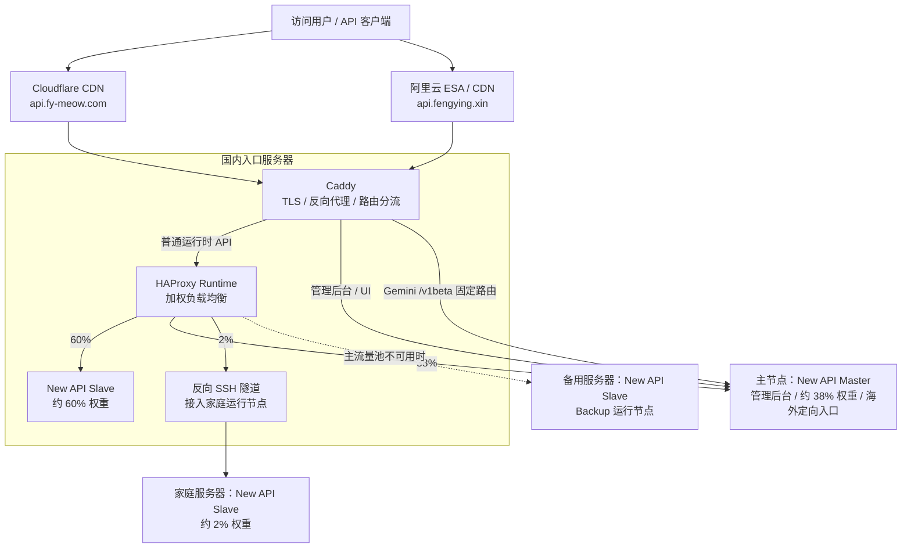
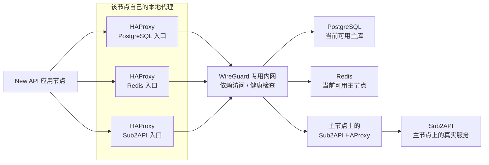
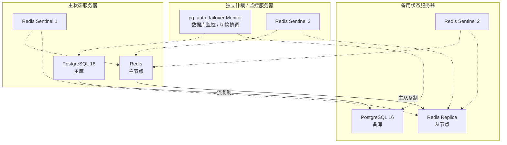

# 给 New API 搭一套实用的高可用架构

最近 IDC 机房有一段时间不太稳定，经常遇到连接失败。我花了一天左右，给 New API 搭了一套偏实用向的高可用架构，先把几个比较容易影响使用的单点拆开。

入口机是这里最重要的一环，所以我选了国内大厂的云服务器。其他节点主要还是中小 IDC 的云服务器，再加一台家庭服务器。我希望这样能在成本、吞吐和稳定性之间找一个目前够用的平衡。

这次还没有做到真正意义上的全链路多活。先把现在怎么接起来、哪些地方能切换、哪些地方还比较脆弱记下来，后面继续折腾时也方便回头看。

## 这次先解决什么

我目前主要想解决五件事：

1. 运行时 API 可以分散到多个节点，不再只依赖一台机器。
2. PostgreSQL 有主备复制，并通过 pg_auto_failover 做自动切换。
3. Redis 有主从复制和三节点 Sentinel，负责监控、仲裁与故障切换。
4. 服务器之间通过 WireGuard 专用内网访问数据库、缓存和健康检查入口。
5. 入口、主节点和备用节点上的应用统一连接本机 HAProxy，由代理和健康检查处理后端主备变化。

家庭节点稍微特殊一点，它通过反向 SSH 隧道接入入口机，也复用入口机上的依赖代理。

## 入口和运行时流量

现在有两个域名入口：`api.fy-meow.com` 走 Cloudflare，`api.fengying.xin` 走阿里云 ESA / CDN。两边最后都回到入口服务器上的 Caddy，由它处理 TLS、反向代理和路由分流。

普通运行时 API 再进入 HAProxy 的加权负载池。目前配置的大致权重是：

| 节点         | 当前分工                                             | 运行时权重                   |
| ------------ | ---------------------------------------------------- | ---------------------------- |
| 国内入口节点 | New API Slave，承担主要运行时请求                    | 约 60%                       |
| 主节点       | New API Master，同时承接管理后台、配置写入和渠道管理 | 约 38%                       |
| 家庭服务器   | 通过反向 SSH 隧道接入，用来兜底和验证                | 约 2%                        |
| 备用节点     | New API Slave，在主流量池不可用时接手                | Backup，不参与平时的权重分配 |

这里写的是配置权重，实际请求分布不一定每次都刚好是 60 / 38 / 2。

Gemini 这一段单独处理。因为上游直接对接 AI Studio，对地域的限制比较多，所以我把 `/v1beta` 固定到海外服务器；在当前路由里，这条请求直接交给主节点，不参加普通运行时的加权分配。

管理后台和 UI 也直接交给 Master。图里的 Backup 是普通运行时负载池的兜底，不代表这两条直连路径也有同样的备用路由。

## 应用怎么访问依赖

我不想让每个应用节点都直接绑定数据库和 Redis 的实际主节点地址，所以在入口、主节点和备用节点上各放了一套本地 HAProxy 入口。

应用连本机代理，代理再通过健康检查选择后端。这样主备角色变化时，应用侧可以继续使用同一个连接地址。连接地址稳定，也不代表切换过程中正在进行的请求就一定不会中断。

下面把重复的部分合并画出来，以入口或备用应用节点为例：

Sub2API 的真实服务目前放在主节点。其他节点通过本地代理和 WireGuard 访问主节点上的 Sub2API 代理；主节点自己的代理则直接连接本机服务。这里多出来的是访问入口，还没有多份 Sub2API 服务副本。

家庭节点的链路要再绕一下：入口机通过隧道把运行时请求送到家里，家庭节点访问 PostgreSQL、Redis 和 Sub2API 时，再通过隧道回到入口机对应的 HAProxy。两种请求方向不同，但都依赖这段隧道和入口机。

## PostgreSQL 和 Redis 的主备

数据库用的是 PostgreSQL 16，主节点和备用节点之间做流复制。独立监控服务器上的 pg_auto_failover Monitor 负责协调数据库的状态与自动切换。

Redis 则是一主一从，加三个 Sentinel。主服务器、备用服务器和独立仲裁 / 监控服务器上各放一个 Sentinel，让缓存层有自己的监控和仲裁。

这张图画的是当前主备角色。虚线表示监控或切换协调，业务请求本身不经过 Monitor 或 Sentinel；真正的数据访问仍然走应用侧的 HAProxy。发生切换以后，主备角色也会跟着变化。

## 还想继续补的地方

现在这套东西能把运行时、数据库和缓存的故障处理分开，但还有几个地方需要继续看：

- 两个 CDN 域名最终还是落在同一台入口机，入口本身仍然很关键。
- 管理后台和 Gemini 的固定路由直接依赖主节点，不能直接套用普通运行时池的兜底方式。
- Sub2API 的真实服务仍然只有主节点这一份，本地代理没有把它变成多活。
- 家庭节点依赖入口机和反向 SSH 隧道，更适合低权重兜底，还不能当成完全独立的一条故障恢复链路。
- 后面还要继续观察故障切换时的连接恢复、请求失败和实际流量分布，再决定下一步补哪里。

目前我更想先把这套架构用起来，看看它在真实使用里表现怎么样。先把边界记清楚，后面继续改时，也不容易把“有备用节点”和“整条链路都高可用”混在一起。

如果你也折腾过类似的架构，或者看到了这里还有什么风险和可以继续优化的地方，欢迎交流。
